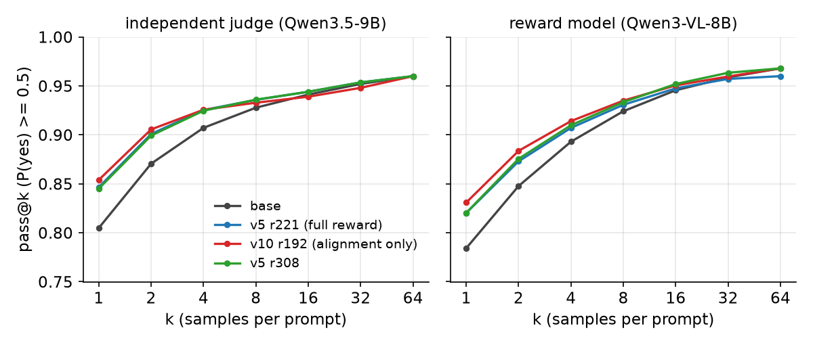
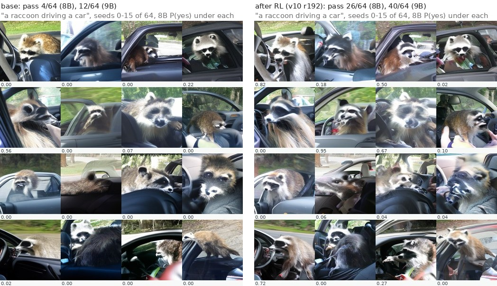
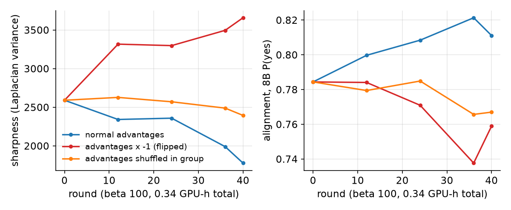
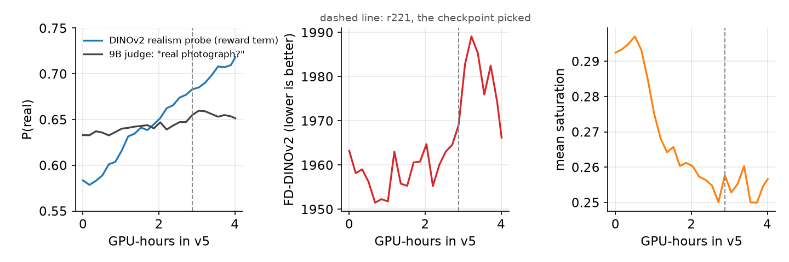

# RL post-training of TinyDiT: what it bought

DGPO on a 209M text-to-image DiT with a VLM alignment reward. The gain is at pass@1 only.

## Findings

- **pass@1 0.81 -> 0.85 under the independent judge (v10 r192; 95 % CI on the gain +0.03 to +0.07); 0.78 -> 0.83 under the reward model (CI +0.02 to +0.07). pass@64 unchanged at 0.96-0.97; the pass@32 gain is -0.004 (CI -0.02 to +0.01, includes 0).** RL concentrates the samples on what the base could already do; it does not add new capability. This is the result of [Yue et al. 2025](https://arxiv.org/abs/2504.13837) for LLM reasoning, reproduced on a small image model.
- **DGPO's preference gate never left 0.5 on this reward, at any beta.** Run means 0.485 (v5) and 0.492 (v10); the beta sweep 100 / 1000 / 5000 gives 0.491 / 0.473 / 0.485. At beta 5000 the gate is a coin flip per group (std 0.36 across the 16 groups). The stage-1 JPEG objective, same code, closed it from 0.43 to 0.07.
- **Image sharpness follows the sign of the advantage, yet the judges show no taste for soft images.** Normal advantages -31 % sharpness in 40 rounds, flipped (x -1) +41 %, shuffled inside each group -8 %. Within-prompt Spearman between judge P(yes) and sharpness on the base's own 64 samples: -0.02 (8B), +0.03 (9B). A guess, not tested: the DGPO update is a denoising MSE pulled toward the preferred samples, and an MSE toward several samples averages them; pushing away from them (flipped) does the reverse.
- **Training only on prompts the base solves 1-6 times out of 8 keeps sharpness (2475 vs 1682, base 2591) at the same pass@1 (0.840 both, 9B, CI on each gain +0.02 to +0.05).** It is not cheaper once the selection pass is counted: 2.04 vs 1.20 GPU-hours. FD-DINOv2 is worse (1973 vs 1953). One run per arm; the training-speed curves rest on two-seed evals.

## Setup

Model: TinyDiT, 208.8M parameters, 256 px rectified flow, FLUX.2 VAE, frozen flan-t5-base; base checkpoint `ema_0400000`.
Algorithm: DGPO ([arXiv 2510.08425](https://arxiv.org/abs/2510.08425)), 16 prompts x 16 samples per round, 10-step ODE rollouts, beta 100, KL 0.001.
Reward: Qwen3-VL-8B P(yes) to "does the image show {prompt}?"; v5 adds a DINOv2 realism probe, HPSv3 and an anatomy question; a CLIP style guard at 0.10 everywhere.
Judge: Qwen3.5-9B, never used in training. Evaluation: 125 held-out prompts, 20-step ODE, CFG 4; pass = P(yes) >= 0.5; pass@k by the unbiased estimator; CIs are paired bootstraps over prompts.
Hardware: one RTX PRO 6000.

## Results

| checkpoint | pass@1 9B | pass@1 8B | pass@32 9B | pass@32 8B | sharpness | FD-DINOv2 | GPU-h |
|---|---|---|---|---|---|---|---|
| base | 0.805 | 0.784 | 0.952 | 0.959 | 2591 | 1929 | 0 |
| v5 r221, full reward | 0.847 | 0.820 | 0.954 | 0.957 | 2216 | 1969 | 3.98 |
| v5 r308 | 0.845 | 0.820 | 0.954 | 0.963 | 2352 | 1966 | 5.11 |
| v10 r192, alignment only | 0.854 | 0.831 | 0.948 | 0.960 | 1940 | 1952 | 6.50 |
| 1.2 h arm, all prompts | 0.840 | 0.813 | 0.952 | 0.968 | 1682 | 1953 | 1.20 |
| 1.2 h arm, band prompts | 0.840 | 0.811 | 0.968 | 0.960 | 2475 | 1973 | 2.04 |

n = 125 prompts; 64 seeds for the first four rows, 32 for the two 1.2 h arms (their own 32-seed base: 0.805 / 0.780 at pass@1, 0.960 / 0.960 at pass@32). pass@32 comes from the per-prompt counts with the unbiased estimator, so every row shares one k. Sharpness is the Laplacian variance and FD-DINOv2 the distance to real photos, from each run's own 125 x 2 evaluation. GPU-hours count the resume chain from the base and, for the band arm, the 0.84 h selection pass. Every pass@1 gain has a 95 % CI excluding 0; no pass@32 gain does.

## Figures



pass@k for the base and three checkpoints. The curves meet by k = 16 (9B) and k = 32 (8B).



"a raccoon driving a car", the prompt the base solves least often: 4 of 64 (8B) and 12 of 64 (9B) before RL, 26 and 40 after. Same seeds in both panels.



Three 40-round runs from the base at beta 100. Shuffled advantages keep the weight movement (KL to the reference 0.0155 vs 0.0167) and do little to either axis.



The reward hack in v5. The DINOv2 realism term rises from 0.58 to 0.72 over 4 GPU-hours while the judge's "real photograph?" moves 0.63 to 0.65 and FD-DINOv2 worsens after r221. Caught by FD-DINOv2 moving against the reward term; the pick rule in `scripts/rl/summarize_run.py` (FD within 1 % of the run's best) chose r221.

## What did not work

- Four stage-2 launches (v1-v4) each exposed a reward-shaping bug within 20 minutes: HPSv3 dominating the advantages, a veto firing on 18 % of samples, a one-sided realism probe rewarding desaturation, a style guard shifting the distribution (`notes/2026-09-23_rl_jpeg_plan.md`).
- Realism and anatomy reward terms soften images within 30-45 minutes (v6, v7, v9). The best artifact judge reaches AUROC 0.79 on real vs generated at 256 px.
- beta 1000 and 5000 learn slower than 100 and soften the same.
- Flow-GRPO SDE rollouts (a = 0.7) are 31 % sharper than ODE samples from the same seeds, so a GRPO comparison needs its own sharpness baseline. Not run.

## Limits

256 px, 209M parameters, one GPU, judge ceilings. Training-time evaluations use 2 seeds per prompt (about +-0.01 on alignment). 2 of the 125 prompts are solved by no checkpoint under either judge. The sharpness mechanism above is a guess.

## Reproduce

From the repo root with `PYTHONPATH=src`; models and data come from the main README's Run section.

```
# alignment-only recipe (the 1.2 h arms; band arm adds --prompts prompts/rl_stage2/train_band.json)
ALIGN="--reward stage2 --alg dgpo --base out/runs/run1/ema_0400000.safetensors --w-align 1.0 --w-real 0 --w-qual 0 \
       --w-anat 0 --w-style 0.10 --lr 2e-5 --beta 0.001 --no-compile --ckpt-every-min 30 --seed 0"
.venv/bin/python -m tinydit.rl.train $ALIGN --run diag_long_beta100 --beta-dpo 100 --ema 0.995 --hours 1.2 --eval-every-min 15
# controls: --adv-sign -1 (flipped) or --adv-shuffle, with --rounds 40 --hours 1 --eval-every-min 6
# v5: --w-align 0.45 --w-real 0.35 --w-qual 0.05 --w-anat 0.15 --w-style 0.1 --lr 1e-5 --beta-dpo 100 --hours 4 from v4 r15
# v10: --w-align 0.9 --w-style 0.1 --lr 2e-5 --ema 0.995 --beta-dpo 100 from v6 r62
.venv/bin/python scripts/rl/judge_evals.py --run diag_long_beta100            # 9B judge over a run's saved evals
.venv/bin/python scripts/rl/passk.py --k 64 --ckpt base=out/runs/run1/ema_0400000.safetensors --ckpt v10_192=out/runs/rl2_dgpo_v10/policy_000192.safetensors
.venv/bin/python scripts/rl/prompt_band.py                                    # 3,000 prompts x 8 seeds -> prompts/rl_stage2/train_band.json
.venv/bin/python scripts/rl/sanity_checks.py                                  # six checks on the loss and samplers
.venv/bin/python scripts/rl/passk_ci.py                                       # the CIs above, CPU only
.venv/bin/python scripts/rl/make_figures.py                                   # this page's figures, CPU only
DGPO_IMPL=solution .venv/bin/python -m pytest exercises/dgpo -q               # the DGPO exercise and its reference
```

Drivers with every flag: `scripts/rl/launch_stage2.sh`, `scripts/rl/diagnostics.sh` to `diagnostics6.sh`. Prompts: `prompts/rl_stage2/{train,train_band,eval}.json`. Seeds: training 0, pass@k 20000+, band 30000+.

## Data

Every number above comes from one of these git-ignored files:

- `out/passk/summary.json`: pass@k and per-prompt counts, 125 x 64; CIs and pass@32 recomputed from `c_per_prompt`.
- `out/passk_long/summary.json`: the two 1.2 h arms and their base, 125 x 32.
- `out/passk/bias_base.json`: judge vs sharpness Spearman.
- `out/runs/<run>/metrics.jsonl`: gate, sharpness, FD-DINOv2, alignment, GPU-hours per round; `judges.jsonl`: the 9B judge.
- `out/diag/prompt_band.json`, `out/logs/diag_prompt_band.log`: band histogram, selection pass time.
- `out/diag/sanity.json`: SDE vs ODE sharpness. `out/reward_eval/analysis.json`: judge AUROC.
